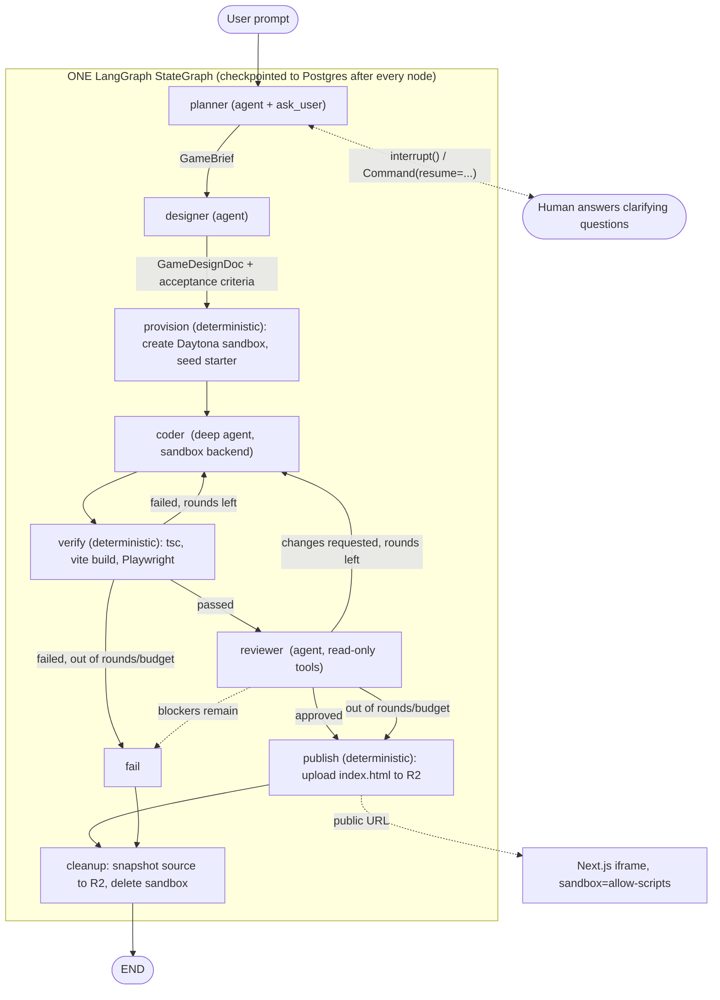
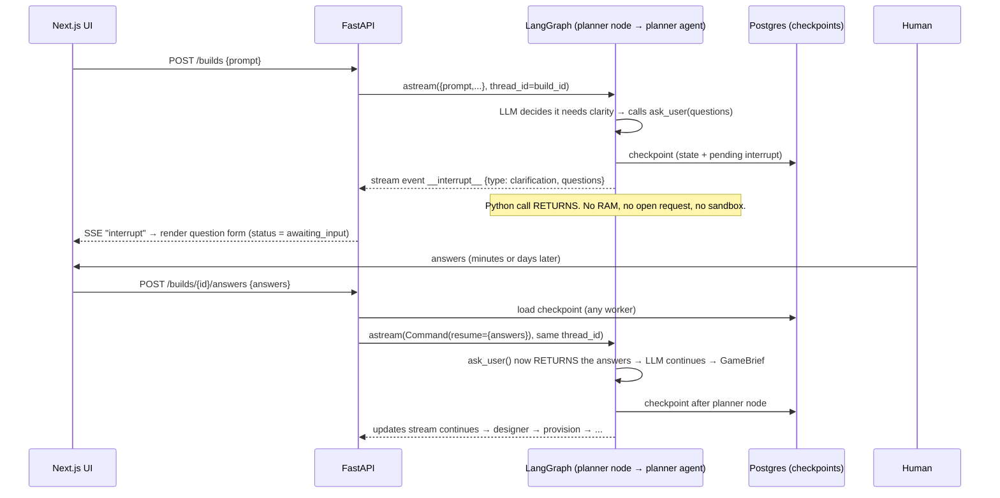

# Rift Agent Orchestration Guide — LangGraph, Deep Agents, HITL, Daytona, Postgres & R2

> **What this guide is:** the build plan for wiring Rift's four agents — **Planner → Designer → Coder ⇄ Reviewer** — into one durable LangGraph workflow with shared context, a human-in-the-loop (HITL) clarification step, a per-build Daytona sandbox, Postgres-backed state, and a single playable `index.html` published to Cloudflare R2 and embedded as an `<iframe>`.
>
> **Verified against the versions in `uv.lock`:** `langgraph 1.2.18`, `langchain 1.4.7`, `deepagents 0.7.32`, `langchain-daytona 0.0.9`, `langchain-openrouter 0.2.9`, `daytona 0.226.1`.
> Code blocks are the **target design** (files marked *new* don't exist yet). They are meant to be copied and adapted, not pasted blindly.
>
> **Related docs:** [`PLAN.md`](PLAN.md) (product plan) · [`SANDBOX_STORAGE_GUIDE.md`](SANDBOX_STORAGE_GUIDE.md) (Daytona adapter, Playwright harness, R2 adapter).

> [!NOTE]
> This replaces the previous "ChartForge" version of the guide. That version used a fictional domain, a different node set (`spec/scaffold/implement/repair`), Gemini models, and a `src/rift/studio/` layout that did not match your repo. Everything below uses your real agents, prompts, config and folder layout.

---

## Table of Contents

1. [The Big Picture — how the whole thing functions](#1-the-big-picture--how-the-whole-thing-functions)
2. [Mental model: one graph, four agents, three layers of shared context](#2-mental-model-one-graph-four-agents-three-layers-of-shared-context)
3. [Audit: what must change in the current files](#3-audit-what-must-change-in-the-current-files)
4. [Dependencies & config](#4-dependencies--config)
5. [Target file layout & import rules](#5-target-file-layout--import-rules)
6. [Shared state (`StudioState`) & structured contracts](#6-shared-state-studiostate--structured-contracts)
7. [Agent factories (the four agents, fixed)](#7-agent-factories-the-four-agents-fixed)
8. [Tools: `ask_user` (HITL) and read-only sandbox tools](#8-tools-ask_user-hitl-and-read-only-sandbox-tools)
9. [Human-in-the-loop for the Planner](#9-human-in-the-loop-for-the-planner)
10. [Sandbox lifecycle: create, persist, restore, terminate](#10-sandbox-lifecycle-create-persist-restore-terminate)
11. [Nodes: how each agent plugs into the graph](#11-nodes-how-each-agent-plugs-into-the-graph)
12. [The Coder ⇄ Reviewer loop](#12-the-coder--reviewer-loop)
13. [Wiring the `StateGraph`](#13-wiring-the-stategraph)
14. [Durability: Postgres checkpointer, `thread_id`, resume & crash recovery](#14-durability-postgres-checkpointer-thread_id-resume--crash-recovery)
15. [Publishing: R2 and the `<iframe>`](#15-publishing-r2-and-the-iframe)
16. [API layer: start, stream (SSE), answer, resume](#16-api-layer-start-stream-sse-answer-resume)
17. [Testing without LLMs, Daytona or R2](#17-testing-without-llms-daytona-or-r2)
18. [What each system prompt must contain](#18-what-each-system-prompt-must-contain)
19. [Implementation order (checklist)](#19-implementation-order-checklist)
20. [Pitfalls & FAQ](#20-pitfalls--faq)

---

## 1. The Big Picture — how the whole thing functions

### End-to-end flow



### Who owns which piece of state?

| Concern | Where it lives | Lifetime | Why there |
|---|---|---|---|
| Conversation + structured hand-offs (brief, GDD, review verdicts, counters, pointers) | **LangGraph state → Postgres checkpoints** (`AsyncPostgresSaver`) | Whole build, survives restarts | Small JSON; enables pause/resume and crash recovery |
| Game source files (`/workspace/**`) while building | **Daytona sandbox filesystem** | Minutes (ephemeral) | Agents need a real FS + shell; this is the only expensive resource |
| Game source files, durable copy | **R2 `builds/<id>/source.tgz`** (+ file manifest in state) | Permanent | Lets you recreate a dead sandbox or start a refinement build |
| Playable game | **R2 `builds/<id>/index.html`** | Permanent, $0 compute | Static file → `<iframe>` |
| Build/Project rows, status, `gdd`, `verify_report`, `artifact_key` | **Postgres app tables** (`builds`, `artifacts`, via SQLAlchemy) | Permanent | What the UI lists/queries; mirrored from graph updates |

> [!IMPORTANT]
> **LangGraph state does not contain the sandbox or its files.** It stores a *pointer* (`sandbox_id`), a *durable copy pointer* (`source_key`) and a small *manifest* (`path → sha256`). File bytes never go in checkpoints — every node writes a checkpoint, so a 5 MB bundle would be copied dozens of times.

### Runtime timeline (what actually happens)

1. **`POST /builds`** → API creates `Build` row (`thread_id = build_id`), starts `graph.astream({prompt,…}, config)` in a background task.
2. **planner** runs. The model decides it needs clarity and calls the `ask_user` tool → tool calls `interrupt({...questions...})`. LangGraph writes a checkpoint to Postgres and **the Python call returns** (no RAM, no open request). The stream emits an `__interrupt__` event; the UI shows the questions; `Build.status = awaiting_input`. **No sandbox exists yet, so you pay nothing while waiting for the human** (hours are fine).
3. User answers → **`POST /builds/{id}/answers`** → `graph.astream(Command(resume={...}), config)` on *any* worker. State reloads from Postgres, the planner continues, and finally returns a validated `GameBrief`.
4. **designer** turns the brief into a `GameDesignDoc` (mechanics, entities, file plan, **acceptance criteria**).
5. **provision** creates the Daytona sandbox (from a snapshot with Node/pnpm/Playwright preinstalled) and seeds the starter into `/workspace`. `sandbox_id` is stored in state.
6. **coder** (Deep Agent whose backend *is* that sandbox) writes the game, runs `pnpm` commands via the `execute` tool, then the node snapshots source to R2.
7. **verify** (no LLM) runs `tsc`, `vite build`, and the Playwright harness. Objective failures go straight back to the coder with no reviewer tokens spent.
8. **reviewer** (LLM, read-only) checks the *passing* build against the acceptance criteria and returns a structured `ReviewVerdict`. If it requests changes, its `fix_instruction`s become the coder's next task → back to step 6.
9. Loop ends on **approve**, or **max rounds / token budget**.
10. **publish** uploads the single-file `dist/index.html` to R2. **cleanup** takes a final source snapshot and **deletes the sandbox**.
11. API mirrors the final state into the `builds`/`artifacts` rows. The frontend renders `<iframe src="{published_url}" sandbox="allow-scripts">`.

---

## 2. Mental model: one graph, four agents, three layers of shared context

### 2.1 Don't build four graphs that talk to each other

The four files in `src/rift/core/agents/` are **compiled agent graphs** (`create_agent` / `create_deep_agent` both return a `CompiledStateGraph`). They are *workers*, not the orchestrator. You add **one** outer `StateGraph(StudioState)` whose nodes call those agents. A "handoff" is simply:

```
node A returns a state update  +  an edge (static or conditional) points to node B
```

| Hand-off mechanism | Use when | In Rift |
|---|---|---|
| **Static edge** `add_edge("designer", "provision")` | Order never changes | planner → designer → provision → coder → verify |
| **Conditional edge** `add_conditional_edges(node, router)` | A *pure function of state* decides | `verify` → review / coder / fail |
| **`Command(update=..., goto=...)`** returned by a node | The node that did the work decides, and update + routing must be atomic | `reviewer` → coder / publish / fail |
| Tool-based handoff (swarm / supervisor, `Command(goto=…, graph=Command.PARENT)`) | The *LLM* should choose the next agent dynamically | **Not used.** Your pipeline is deterministic; letting an LLM route adds cost and failure modes. Revisit only if you add optional agents (e.g. an art agent). |

### 2.2 Three layers of shared context

"Messages and context intact" is achieved by **sharing state, not by dumping one giant message list into every agent**.

```
LAYER 1  messages (add_messages)   Human-readable hand-off log + the user's chat feed:
                                   user prompt, Q&A, one short named AIMessage per agent
                                   ("planner: brief ready…", "reviewer: 3 issues…").
LAYER 2  structured artifacts      brief, gdd (with acceptance_criteria), verify_report,
                                   review, review_history, coder_summary.
                                   Typed, validated, the real contract between agents.
LAYER 3  environment pointers      sandbox_id, source_key, files manifest,
                                   artifact_key, published_url.
```

Each agent node builds the agent's **input from the layers it needs** (its "view"):

| Agent | Reads | Writes to state |
|---|---|---|
| **planner** | user prompt (`messages[0]`), human answers (via `interrupt`) | `brief` |
| **designer** | `prompt`, `brief` | `gdd` (mechanics, file plan, `acceptance_criteria`) |
| **coder** | `gdd`, latest `verify_report` **or** `review`, previous `coder_summary`, and **the sandbox files** | sandbox files, `source_key`, `files`, `coder_summary` |
| **reviewer** | `gdd.acceptance_criteria`, `verify_report`, screenshots, sandbox files (read-only) | `review`, `review_history` |

> [!TIP]
> **Why not pass the full `messages` list to every agent?**
> (1) The coder's tool-call chatter is hundreds of messages — it would drown the reviewer and blow small free-model context windows. (2) Each agent has a different system prompt/role; mixing transcripts makes models role-confuse. (3) You pay for every re-read token. Instead each agent starts with a **fresh, curated context** and the *durable* context travels in typed state + the sandbox filesystem. The coder "remembers" prior rounds through `coder_summary` and the files themselves, which is what actually matters.

### 2.3 Why agents are *called inside* nodes (not added directly as nodes)

You can pass a compiled agent straight to `add_node`, but it then shares state keys with the parent by name (`messages`) and the agent object must exist at graph-build time. Rift needs the opposite: the **coder is bound to a specific sandbox that doesn't exist until `provision` runs**, and every agent needs a curated input and a mapped output. So each node is a small function that builds the agent, invokes it, and returns a state update. Interrupts and checkpointing still work through the nesting because the agents are compiled with **no checkpointer of their own** (see §14).

---

## 3. Audit: what must change in the current files

| # | File | Problem | Fix |
|---|---|---|---|
| 1 | [`coder_agent.py`](src/rift/core/agents/coder_agent.py) | `sandbox = Daytona().create()` runs **at import time**: importing the module creates a billable sandbox, and every build would share it. | Make it a factory `build_coder_agent(sandbox_id)` (§7). Sandbox creation belongs to the `provision` node. |
| 2 | [`plan-agent.py`](src/rift/core/agents/plan-agent.py) | Hyphen in filename → cannot be imported as a module. | Rename to `plan_agent.py`. |
| 3 | `plan-agent.py` | `model="nvidia/nemotron-3.5-super-vl:free"` is a bare string; `init_chat_model` can't infer a provider from it. | Use the shared `make_model("plan")` that returns `ChatOpenRouter` (§7). |
| 4 | all four agents | Module-level singletons → no per-build tools possible; plan agent has no `ask_user`; review agent has no way to read files. | Factory functions that accept their tools/ids (§7). |
| 5 | `core/prompts/*.py` | All four prompts are empty strings. | See §18 for what each must contain. |
| 6 | [`config.py`](src/rift/config.py) | Secrets are loaded by `pydantic-settings` into `RiftSettings` **only** — they are *not* exported to `os.environ`. `ChatOpenRouter()` and `Daytona()` read env vars, so they would silently see no key. | Pass keys explicitly: `ChatOpenRouter(api_key=…)`, `Daytona(DaytonaConfig(api_key=…))`. |
| 7 | `config.py` | Missing `r2_account_id`, `r2_bucket`, `r2_public_base_url`, `daytona_snapshot`. | Add (§4). |
| 8 | [`pyproject.toml`](pyproject.toml) | `deepagents` is only a transitive dep; `langgraph` is not declared; **`langgraph-checkpoint-postgres` and `psycopg` are not installed** (verified in `.venv`); no `boto3`, no web framework. | `uv add` list in §4. |
| 9 | `schemas.py` vs `models.py` | `ArtifactKind.STATIC_BUNDLE = "static-bundle"` but schema literal is `"static_bundle"`. | Pick one (use `static_bundle`) and migrate. |
| 10 | `BuildStatus` | No value for "waiting for human answers", "planning", "reviewing". | Add `planning`, `awaiting_input`, `reviewing` (Alembic: `ALTER TYPE … ADD VALUE`). |
| 11 | `Build` table | No column for the planner's brief. | Add `brief JSONB`, or nest it as `gdd["brief"]`. |
| 12 | [`ports/sandbox.py`](src/rift/core/ports/sandbox.py) | No way to ask "is this sandbox still alive?", `exec` has no `cwd`/`timeout`. | Add `exists()`, `timeout` param (§10). |
| 13 | `toolbox/sandbox_tools.py` | Empty. | Read-only tools for the reviewer + `ask_user` (§8). |

---

## 4. Dependencies & config

```bash
uv add langgraph deepagents "langgraph-checkpoint-postgres" "psycopg[binary,pool]" boto3
uv add fastapi "uvicorn[standard]" sse-starlette       # API layer (§16)
```

`config.py` additions:

```python
class RiftSettings(BaseSettings):
    ...
    daytona_snapshot: str = "rift-sandbox"   # snapshot with node, pnpm, playwright + chromium preinstalled
    r2_account_id: str | None = None
    r2_bucket: str = "rift-artifacts"
    r2_public_base_url: str = ""              # e.g. https://play.rift.example  (custom domain, NOT r2.dev)
    max_attempts: int = 4                     # reused as max coder rounds
    token_budget: int = 250_000
```

**Two different Postgres URLs.** SQLAlchemy uses `postgresql+asyncpg://…` (your `normalize_database_url`). The LangGraph checkpointer uses **psycopg**, which needs plain `postgresql://…`. Derive it, don't duplicate it (§14).

---

## 5. Target file layout & import rules

```text
src/rift/
├─ config.py
├─ core/
│  ├─ llm.py                        # NEW  make_model(role)
│  ├─ domain/
│  │  ├─ schemas.py                 # exists (Build, Artifact, …)
│  │  └─ gdd.py                     # NEW  GameBrief, GameDesignDoc, ReviewVerdict, Question
│  ├─ ports/
│  │  ├─ sandbox.py                 # exists (+ exists())
│  │  └─ storage.py                 # exists
│  ├─ prompts/                      # exists — fill the four prompts
│  ├─ toolbox/
│  │  ├─ sandbox_tools.py           # read-only tools for the reviewer
│  │  └─ interaction_tools.py       # NEW  ask_user (HITL)
│  ├─ agents/                       # factories only; no side effects at import
│  │  ├─ plan_agent.py              # RENAMED from plan-agent.py
│  │  ├─ design_agent.py
│  │  ├─ coder_agent.py
│  │  └─ review_agent.py
│  └─ studio/                       # NEW  the orchestration layer
│     ├─ state.py                   #   StudioState + reducers
│     ├─ sandbox_lifecycle.py       #   ensure_sandbox / snapshot_source / teardown
│     ├─ nodes.py                   #   StudioNodes (one method per node)
│     ├─ routing.py                 #   pure routers
│     └─ graph.py                   #   build_studio_graph(...)
├─ adapters/                        # DaytonaSandboxProvider, R2StorageProvider, memory fakes
├─ memory/checkpointer.py           # NEW  AsyncPostgresSaver helper
├─ verify/                          # harness_script.py, runner.py (see SANDBOX_STORAGE_GUIDE)
└─ api/builds.py                    # NEW  FastAPI routes + SSE; the *composition root*
```

```text
domain/ + ports/ + prompts/        ← import nothing from the project except each other
        ▲
toolbox/  llm.py                   ← domain, ports
        ▲
agents/                            ← toolbox, prompts, domain, llm (vendor SDKs allowed here)
        ▲
studio/                            ← agents (via injected factories), ports, domain
        ▲
api/ (composition root)            ← wires adapters + checkpointer + studio; the ONLY place that
                                     knows Daytona/R2/Postgres concrete classes together
```

`studio/` never imports `daytona`, `boto3` or `psycopg`; it talks to `SandboxProvider` / `StorageProvider` and to agent factories it is handed. That's what makes it testable (§17).

---

## 6. Shared state (`StudioState`) & structured contracts

### 6.1 Reducers in one minute

- A node returns a **partial** dict; LangGraph merges it into state.
- By default a returned key **overwrites**. For append/accumulate semantics annotate the key with a **reducer**: `Annotated[list, add_messages]`, `Annotated[list, operator.add]`, `Annotated[int, operator.add]`.
- Store **plain JSON** (`model.model_dump()`), not Pydantic objects: checkpoints stay inspectable in SQL and survive model changes. Re-validate on read (`GameDesignDoc.model_validate(state["gdd"])`).

```python
# src/rift/core/studio/state.py
import operator
from typing import Annotated, Any, Literal, TypedDict

from langchain_core.messages import AnyMessage
from langgraph.graph.message import add_messages

StudioStatus = Literal[
    "queued", "planning", "awaiting_input", "designing", "building",
    "verifying", "reviewing", "published", "failed", "budget_exceeded",
]


class StudioState(TypedDict, total=False):
    # ── identity / tenancy ────────────────────────────────────────────
    org_id: str
    project_id: str
    build_id: str                    # also the LangGraph thread_id
    parent_build_id: str | None      # set for refinement builds

    # ── LAYER 1: shared conversation / hand-off log ───────────────────
    prompt: str
    messages: Annotated[list[AnyMessage], add_messages]

    # ── LAYER 2: structured artifacts passed between agents ───────────
    brief: dict[str, Any]            # GameBrief       (planner  → designer)
    gdd: dict[str, Any]              # GameDesignDoc   (designer → coder, reviewer)
    verify_report: dict[str, Any] | None   # deterministic results (verify → coder/reviewer)
    review: dict[str, Any] | None          # latest ReviewVerdict (reviewer → coder)
    review_history: Annotated[list[dict[str, Any]], operator.add]  # append-only audit trail
    coder_summary: str | None        # what the coder did last round (coder → reviewer / next coder run)

    # ── LAYER 3: environment pointers (NOT file contents) ─────────────
    sandbox_id: str | None
    source_key: str | None           # R2 key of latest source tarball
    files: dict[str, str]            # manifest: path -> sha256
    artifact_key: str | None         # R2 key of published index.html
    published_url: str | None

    # ── control & budgets ─────────────────────────────────────────────
    round: int                       # number of coder runs so far
    max_rounds: int
    tokens_used: Annotated[int, operator.add]
    token_budget: int
    status: StudioStatus
    error: str | None
```

> [!NOTE]
> `tokens_used` uses `operator.add`, so every node returns only its **delta** (`{"tokens_used": 1234}`), never the running total.

### 6.2 Structured contracts (`core/domain/gdd.py`, *new*)

These Pydantic models are the **typed hand-offs**. They are used as `response_format` for the agents, so the model is forced to return valid data and you never `json.loads()` raw text.

```python
# src/rift/core/domain/gdd.py
from typing import Literal

from pydantic import BaseModel, Field, model_validator


# ── Planner ⇄ human ─────────────────────────────────────────────────
class Question(BaseModel):
    id: str = Field(description="Short stable id, e.g. 'genre'")
    question: str
    options: list[str] = Field(default_factory=list, description="Suggested answers (may be empty)")
    allow_free_text: bool = True


class GameBrief(BaseModel):
    """Planner output: everything the designer needs, with ambiguities resolved."""
    title: str = Field(min_length=2, max_length=60)
    genre: str
    elevator_pitch: str
    core_loop: str
    controls: list[str]
    win_condition: str
    lose_condition: str
    art_style: str
    session_length_minutes: int = Field(ge=1, le=30, default=3)
    assumptions: list[str] = Field(default_factory=list, description="Things we decided WITHOUT asking")
    out_of_scope: list[str] = Field(default_factory=list)


# ── Designer ────────────────────────────────────────────────────────
class AcceptanceCriterion(BaseModel):
    id: str                                  # "AC1"
    description: str                         # observable, testable statement
    check: Literal["runtime", "visual", "code"]


class FilePlanItem(BaseModel):
    path: str                                # "src/scenes/GameScene.ts"
    purpose: str


class GameDesignDoc(BaseModel):
    title: str
    mechanics: list[str]
    entities: list[str]                      # player, enemies, pickups, ... with behaviour
    levels_or_waves: list[str]
    hud_and_menus: list[str]
    palette_hex: list[str] = Field(min_length=3, max_length=8)
    audio: str = "WebAudio synthesized beeps; no external files"
    file_plan: list[FilePlanItem]
    acceptance_criteria: list[AcceptanceCriterion] = Field(min_length=3)


# ── Reviewer ────────────────────────────────────────────────────────
class ReviewIssue(BaseModel):
    severity: Literal["blocker", "major", "minor"]
    criterion_id: str | None = None          # which acceptance criterion it violates
    file: str | None = None
    problem: str
    fix_instruction: str = Field(description="Imperative, specific instruction for the coder")


class ReviewVerdict(BaseModel):
    approved: bool
    summary: str
    issues: list[ReviewIssue] = Field(default_factory=list)

    @model_validator(mode="after")
    def _approved_means_no_blockers(self) -> "ReviewVerdict":
        if self.approved and any(i.severity in ("blocker", "major") for i in self.issues):
            raise ValueError("approved=True is incompatible with blocker/major issues")
        return self
```

> [!TIP]
> The `acceptance_criteria` are the **shared contract of the loop**: the designer writes them, the coder builds toward them, the reviewer grades against them, and `ReviewIssue.criterion_id` ties feedback back to them. This is what keeps the Coder ⇄ Reviewer loop from drifting into endless subjective nitpicking.

**Mapping to your DB** (`builds` table): `gdd` ← `state["gdd"]`; `plan` ← `state["gdd"]["file_plan"]`; `verify_report` ← `{"verify": …, "review": …}`; `artifact_key` ← `state["artifact_key"]`; add a `brief` column (§3 #11).

---

## 7. Agent factories (the four agents, fixed)

### 7.1 One place to construct models

```python
# src/rift/core/llm.py   (NEW)
from typing import Literal

from langchain_openrouter import ChatOpenRouter

from rift.config import get_settings

Role = Literal["plan", "design", "code", "review"]

# One knob per role. All free today; swap the coder/reviewer to stronger models first.
MODEL_BY_ROLE: dict[Role, str] = {
    "plan": "nvidia/nemotron-3.5-super-vl:free",
    "design": "nvidia/nemotron-3.5-super-vl:free",
    "code": "nvidia/nemotron-3.5-super-vl:free",
    "review": "nvidia/nemotron-3.5-super-vl:free",
}
TEMPERATURE: dict[Role, float] = {"plan": 0.4, "design": 0.5, "code": 0.2, "review": 0.0}


def make_model(role: Role) -> ChatOpenRouter:
    s = get_settings()
    key = s.openrouter_api_key.get_secret_value() if s.openrouter_api_key else None
    return ChatOpenRouter(
        model=MODEL_BY_ROLE[role],
        api_key=key,                 # config.py does NOT populate os.environ — pass explicitly
        temperature=TEMPERATURE[role],
        max_retries=3,
    )
```

> [!WARNING]
> Free OpenRouter models are rate-limited and vary in tool-calling quality. The whole design depends on reliable **tool calling** (structured output via `ToolStrategy`, `ask_user`, file tools). If you see malformed tool calls, change `MODEL_BY_ROLE` — nothing else needs to move.

### 7.2 Planner — `create_agent` + `ask_user` + structured output

```python
# src/rift/core/agents/plan_agent.py   (renamed; no import-time side effects)
from langchain.agents import create_agent
from langchain.agents.middleware import ToolCallLimitMiddleware
from langchain.agents.structured_output import ToolStrategy

from rift.core.domain.gdd import GameBrief
from rift.core.llm import make_model
from rift.core.prompts import PLAN_AGENT_PROMPT
from rift.core.toolbox.interaction_tools import ask_user


def build_plan_agent():
    return create_agent(
        model=make_model("plan"),
        tools=[ask_user],
        system_prompt=PLAN_AGENT_PROMPT,
        response_format=ToolStrategy(GameBrief),     # final answer = validated GameBrief
        middleware=[
            # hard cap on clarification rounds; extra calls get a "limit reached" ToolMessage
            ToolCallLimitMiddleware(tool_name="ask_user", run_limit=3, exit_behavior="continue"),
        ],
        name="planner",
        # NO checkpointer= here: it must inherit the parent graph's Postgres saver (§14)
    )
```

Result is read as `result["structured_response"]` (a `GameBrief`).

### 7.3 Designer — pure structured output, no tools

```python
# src/rift/core/agents/design_agent.py
from langchain.agents import create_agent
from langchain.agents.structured_output import ToolStrategy

from rift.core.domain.gdd import GameDesignDoc
from rift.core.llm import make_model
from rift.core.prompts import DESIGN_AGENT_PROMPT


def build_design_agent():
    return create_agent(
        model=make_model("design"),
        system_prompt=DESIGN_AGENT_PROMPT,
        response_format=ToolStrategy(GameDesignDoc),
        name="designer",
    )
```

If you never need tools here, `make_model("design").with_structured_output(GameDesignDoc)` is a lighter alternative to a full agent loop.

### 7.4 Coder — Deep Agent bound to *this build's* sandbox

`create_deep_agent` gives you: file tools (`ls/read_file/write_file/edit_file/glob/grep`), an **`execute`** shell tool (because the backend is a *sandbox* backend), a `write_todos` planning tool, and `task` sub-agent delegation (context isolation per module).

```python
# src/rift/core/agents/coder_agent.py
from daytona import Daytona, DaytonaConfig
from deepagents import create_deep_agent
from langchain_daytona import DaytonaSandbox

from rift.config import get_settings
from rift.core.llm import make_model
from rift.core.prompts import CODER_AGENT_PROMPT


def build_coder_agent(sandbox_id: str):
    """BLOCKING (sync Daytona SDK) — call via `asyncio.to_thread` from async code."""
    s = get_settings()
    client = Daytona(DaytonaConfig(api_key=s.daytona_api_key.get_secret_value()))
    sandbox = client.get(sandbox_id)                 # attach to the EXISTING sandbox
    return create_deep_agent(
        model=make_model("code"),
        system_prompt=CODER_AGENT_PROMPT,
        backend=DaytonaSandbox(sandbox=sandbox),     # file tools + execute run INSIDE Daytona
        name="coder",
    )
```

> [!IMPORTANT]
> **Two Daytona clients, one sandbox.** `langchain-daytona`'s `DaytonaSandbox` needs the **sync** `daytona.Sandbox`; your deterministic nodes use the **async** `SandboxProvider` adapter (`AsyncDaytona`). Both address the same remote sandbox by `sandbox_id`, so files the coder writes via the backend are immediately visible to `verify`/`reviewer`/`publish` through the provider. The backend is fixed when the agent is created, which is exactly why the coder agent must be built **per build, after `provision`**.

### 7.5 Reviewer — read-only tools + structured verdict

The reviewer gets **read-only** tools (it cannot "fix it quietly" — it must instruct the coder). Reuses the async `SandboxProvider` through closure-bound tools (§8.2).

```python
# src/rift/core/agents/review_agent.py
from langchain.agents import create_agent
from langchain.agents.structured_output import ToolStrategy

from rift.core.domain.gdd import ReviewVerdict
from rift.core.llm import make_model
from rift.core.ports.sandbox import SandboxProvider
from rift.core.prompts import REVIEW_AGENT_PROMPT
from rift.core.toolbox.sandbox_tools import make_readonly_tools


def build_review_agent(sandbox: SandboxProvider, sandbox_id: str):
    return create_agent(
        model=make_model("review"),
        tools=make_readonly_tools(sandbox, sandbox_id),
        system_prompt=REVIEW_AGENT_PROMPT,
        response_format=ToolStrategy(ReviewVerdict),
        name="reviewer",
    )
```

`nvidia/nemotron-…-vl` is vision-capable: you may attach the Playwright screenshots (`screenshot_t0/t1.png`) to the review task as image content blocks so the reviewer can judge visuals, not just code.

---

## 8. Tools: `ask_user` (HITL) and read-only sandbox tools

### 8.1 `ask_user` — a tool whose body is `interrupt()`

```python
# src/rift/core/toolbox/interaction_tools.py   (NEW)
from langchain_core.tools import tool
from langgraph.types import interrupt

from rift.core.domain.gdd import Question


@tool
def ask_user(questions: list[Question]) -> str:
    """Ask the human clarifying questions about the game they want.

    Send ALL your questions in ONE call (max 5). Only ask what would materially change the game.
    Offer sensible `options` so the user can answer with one click.
    """
    # Execution PAUSES here. The graph is checkpointed to Postgres and the process can exit.
    # On resume, this call returns the value passed to Command(resume=...).
    answers: dict[str, str] = interrupt(
        {
            "type": "clarification",
            "questions": [q.model_dump() for q in questions],
        }
    )
    # Feed answers back to the LLM as plain text it can reason over.
    lines = [f"- {q.id}: {answers.get(q.id, '(no answer — choose a sensible default and list it as an assumption)')}"
             for q in questions]
    return "User answers:\n" + "\n".join(lines)
```

### 8.2 Read-only sandbox tools (reviewer)

```python
# src/rift/core/toolbox/sandbox_tools.py
import shlex

from langchain_core.tools import BaseTool, tool

from rift.core.ports.sandbox import SandboxProvider

WORKSPACE = "/workspace"


def make_readonly_tools(sandbox: SandboxProvider, sandbox_id: str) -> list[BaseTool]:
    """Tools bound (by closure) to ONE sandbox. No write/exec-anything tools on purpose."""

    @tool
    async def list_files(subdir: str = "src") -> str:
        """List files under /workspace/<subdir> (excludes node_modules and dist)."""
        res = await sandbox.exec(
            sandbox_id,
            ["sh", "-c", f"cd {WORKSPACE} && find {shlex.quote(subdir)} -type f -not -path '*/node_modules/*' | sort | head -200"],
        )
        return res.stdout if res.exit_code == 0 else f"error: {res.stderr}"

    @tool
    async def read_file(path: str) -> str:
        """Read a UTF-8 file under /workspace (path relative to /workspace, e.g. 'src/main.ts')."""
        if ".." in path or path.startswith("/"):
            return "error: path must be relative and inside /workspace"
        raw = await sandbox.read_file(sandbox_id, f"{WORKSPACE}/{path}")
        return raw.decode("utf-8", errors="replace")[:30_000]     # cap context cost

    @tool
    async def grep_code(pattern: str) -> str:
        """Search /workspace/src for a fixed string. Returns file:line:match (max 100 lines)."""
        res = await sandbox.exec(
            sandbox_id, ["sh", "-c", f"cd {WORKSPACE} && grep -rnF --include='*.ts' -- {shlex.quote(pattern)} src | head -100"]
        )
        return res.stdout or "no matches"

    return [list_files, read_file, grep_code]
```

---

## 9. Human-in-the-loop for the Planner

### 9.1 What happens, step by step



### 9.2 Why it works through the nesting

`planner_node` (outer graph) calls `plan_agent.ainvoke(...)` (inner graph) which calls the `ask_user` tool, which calls `interrupt()`. Because the inner agent is compiled **without its own checkpointer**, it inherits the outer one, and the interrupt bubbles all the way up and is persisted under the outer `thread_id`.

On resume LangGraph **re-executes `planner_node` from its first line** — but the inner agent restores from *its* checkpoint, so the LLM calls that already happened are **not** repeated; only the `ask_user` tool call re-runs and this time `interrupt()` returns the human's answer.

### 9.3 Contract

| Direction | Payload (JSON only) |
|---|---|
| Graph → UI (`__interrupt__`) | `{"type":"clarification","questions":[{"id":"genre","question":"Which genre?","options":["Shooter","Platformer","Puzzle"],"allow_free_text":true}]}` |
| UI → Graph (`Command(resume=…)`) | `{"genre":"Shooter","controls":"Keyboard + mouse"}` — keyed by `Question.id`; omit a key = "skip, choose for me" |

### 9.4 The rules (violating any one gives confusing bugs)

1. **Never wrap `interrupt()` in `try/except`.** It works by raising a control-flow exception. `ask_user` above has no `except`.
2. **No non-idempotent side effects before the interrupt in the same node.** The node body re-runs on resume. `planner_node` therefore does *nothing* but build input → invoke agent → return update. Sandbox creation, DB writes, uploads all live in **other** nodes.
3. **Keep payloads and resume values small and JSON-serializable** (they're stored in the checkpoint).
4. **Don't reorder or conditionally skip `interrupt()` calls inside a node** — resume values are matched positionally.
5. **Ask in batches.** If the model emits two *parallel* `ask_user` calls you get two simultaneous interrupts, and resume then requires `Command(resume={interrupt_id: value, …})`. The tool takes a *list* of questions precisely so one call is enough; the tool docstring + prompt say "ONE call". `ToolCallLimitMiddleware(run_limit=3)` caps total rounds.

### 9.5 Designing the questions (this is what makes plans "high clarity")

Put these rules in `PLAN_AGENT_PROMPT` (see §18):
- Ask **only** what would materially change the game (genre, perspective, controls/input device, win/lose, art style, session length, difficulty, must-have/must-not features).
- Never ask what a sensible default covers. Make that call yourself and record it in `GameBrief.assumptions` so the user can see and veto it later.
- Offer 2–4 concrete `options` per question; the UI renders one-click chips plus a free-text box.
- Max 5 questions per call, max 3 rounds. After that, **decide and produce the brief**.
- If the user's prompt is already specific, ask **zero** questions. HITL is optional per run.

### 9.6 Detecting the pause and surfacing it

```python
async for mode, chunk in graph.astream(inp, config, stream_mode=["updates", "custom"]):
    if mode == "updates" and "__interrupt__" in chunk:
        intr = chunk["__interrupt__"][0]          # langgraph.types.Interrupt
        payload, interrupt_id = intr.value, intr.id
        # → set Build.status = "awaiting_input", push SSE "interrupt" event, STOP consuming
```
Afterwards `await graph.aget_state(config)` shows `state.next == ("planner",)` and `state.tasks[0].interrupts` — useful for a "reload page and still see the pending questions" endpoint (§16).

> [!NOTE]
> **Alternative design:** make the Q&A an explicit graph loop (`planner → ask_user_node → planner`). It is more visible in diagrams but re-invokes the LLM each turn with the whole history. The tool-based interrupt keeps the planner's reasoning in one agent run and is the idiomatic choice.

> [!TIP]
> **Waiting for a human costs nothing**, but only because `provision` comes *after* the planner. Keep that ordering. If you later add a human approval step *after* the build, snapshot-and-delete (or `stop`) the sandbox before pausing — a running sandbox bills while the human thinks.

---

## 10. Sandbox lifecycle: create, persist, restore, terminate

### 10.1 The rule

> The sandbox is a **cache of the workspace**, never the source of truth. The source of truth is **`source_key` (R2 tarball) + manifest in state**. Any node must be able to continue if the sandbox has vanished.

### 10.2 Extend the port

```python
# src/rift/core/ports/sandbox.py  (additions)
class SandboxProvider(Protocol):
    async def create(self, *, labels: dict[str, str] | None = None) -> str: ...
    async def exists(self, sandbox_id: str) -> bool: ...          # NEW: alive (or restartable)?
    async def read_file(self, sandbox_id: str, path: str) -> bytes: ...
    async def write_file(self, sandbox_id: str, content: bytes, path: str) -> None: ...
    async def exec(self, sandbox_id: str, cmd: list[str], *, timeout: int = 120) -> ExecResult: ...
    async def terminate(self, sandbox_id: str) -> None: ...        # MUST be idempotent
```

Daytona adapter parts that matter (see [`SANDBOX_STORAGE_GUIDE.md`](SANDBOX_STORAGE_GUIDE.md) §3 for the rest):

```python
# src/rift/adapters/daytona.py (additions)
from daytona import DaytonaNotFoundError, SandboxState

async def exists(self, sandbox_id: str) -> bool:
    try:
        sb = await self._client.get(sandbox_id)
    except DaytonaNotFoundError:
        return False
    if sb.state == SandboxState.STARTED:
        self._sandboxes[sandbox_id] = sb
        return True
    if sb.state in (SandboxState.STOPPED, SandboxState.ARCHIVED):   # filesystem persists → just restart
        await sb.start()
        self._sandboxes[sandbox_id] = sb
        return True
    return False                                                     # destroyed / error / building…

async def terminate(self, sandbox_id: str) -> None:
    try:
        sb = await self._get_sandbox(sandbox_id)
        await self._client.delete(sb)
    except DaytonaNotFoundError:
        pass                                                         # already gone = success
    finally:
        self._sandboxes.pop(sandbox_id, None)
```

Create sandboxes with `CreateSandboxFromSnapshotParams(snapshot=…, auto_stop_interval=15, auto_delete_interval=60, labels={"build_id": …})` — the labels let a reaper cron find orphans (§10.5).

### 10.3 What gets saved, when

```text
provision ─ create sandbox ─ seed starter ─────────────────────► state.sandbox_id
coder (each round) ─ agent edits files ─ snapshot_source() ────► R2 builds/<id>/source.tgz
                                                                 state.source_key, state.files (manifest)
verify / reviewer / publish ─ read-only use of the sandbox
cleanup ─ final snapshot_source() ─ terminate() ───────────────► state.sandbox_id = None
          (API then writes an `artifacts` row kind="source" pointing at source_key)
```

```python
# src/rift/core/studio/sandbox_lifecycle.py   (NEW — deterministic helpers, no LLM)
import logging

from rift.core.ports.sandbox import SandboxProvider
from rift.core.ports.storage import StorageProvider

log = logging.getLogger(__name__)
WORKSPACE = "/workspace"
_EXCLUDES = "--exclude=node_modules --exclude=dist --exclude=.git"


async def seed_starter(sandbox: SandboxProvider, sandbox_id: str) -> None:
    # Starter + node_modules are baked into the Daytona snapshot at /opt/starter → instant, offline.
    res = await sandbox.exec(
        sandbox_id,
        ["sh", "-c", f"mkdir -p {WORKSPACE} && cp -a /opt/starter/topdown-shooter/. {WORKSPACE}/"],
    )
    if res.exit_code != 0:
        raise RuntimeError(f"seed_starter failed: {res.stderr}")
    # verify_game.py = the Playwright harness (src/rift/verify/harness_script.py)
    from rift.verify.harness_script import HARNESS_SCRIPT   # whatever your module exports
    await sandbox.write_file(sandbox_id, HARNESS_SCRIPT.encode(), f"{WORKSPACE}/verify_game.py")


async def snapshot_source(
    sandbox: SandboxProvider, storage: StorageProvider, sandbox_id: str, build_id: str
) -> tuple[str, dict[str, str]]:
    """Tar the workspace (no node_modules/dist/.git) → R2. Returns (key, {path: sha256})."""
    script = (
        f"cd {WORKSPACE} && tar czf /tmp/src.tgz {_EXCLUDES} . && "
        "find . -type f -not -path './node_modules/*' -not -path './dist/*' -not -path './.git/*' "
        "-exec sha256sum {} +"
    )
    res = await sandbox.exec(sandbox_id, ["sh", "-c", script])
    if res.exit_code != 0:
        raise RuntimeError(f"snapshot_source failed: {res.stderr}")
    manifest = {}
    for line in res.stdout.splitlines():
        if line.strip():
            digest, path = line.split(None, 1)
            manifest[path.removeprefix("./")] = digest
    data = await sandbox.read_file(sandbox_id, "/tmp/src.tgz")
    key = f"builds/{build_id}/source.tgz"                       # overwritten each round = "latest"
    await storage.upload_file(key, data, content_type="application/gzip")
    return key, manifest


async def restore_source(
    sandbox: SandboxProvider, storage: StorageProvider, sandbox_id: str, key: str
) -> None:
    await sandbox.write_file(sandbox_id, await storage.get_file(key), "/tmp/src.tgz")
    script = (
        f"mkdir -p {WORKSPACE} && tar xzf /tmp/src.tgz -C {WORKSPACE} && "
        f"cd {WORKSPACE} && pnpm install --frozen-lockfile"
    )
    res = await sandbox.exec(sandbox_id, ["sh", "-c", script], timeout=300)
    if res.exit_code != 0:
        raise RuntimeError(f"restore_source failed: {res.stderr}")


async def ensure_sandbox(
    sandbox: SandboxProvider, storage: StorageProvider, state: dict
) -> tuple[str, bool]:
    """Idempotent. Returns (sandbox_id, was_recreated). Safe to call at the top of ANY node."""
    sid = state.get("sandbox_id")
    if sid and await sandbox.exists(sid):
        return sid, False
    sid = await sandbox.create(labels={"build_id": state["build_id"], "org_id": state["org_id"]})
    if key := state.get("source_key"):
        await restore_source(sandbox, storage, sid, key)    # sandbox died mid-build, or refinement build
    else:
        await seed_starter(sandbox, sid)
    return sid, True


async def teardown(
    sandbox: SandboxProvider, storage: StorageProvider, state: dict
) -> dict:
    """Final snapshot (best effort) then delete. Returns a state update."""
    sid = state.get("sandbox_id")
    if not sid:
        return {}
    update: dict = {}
    try:
        if await sandbox.exists(sid):
            try:
                key, manifest = await snapshot_source(sandbox, storage, sid, state["build_id"])
                update = {"source_key": key, "files": manifest}
            except Exception:                                # last-round snapshot already exists
                log.exception("final snapshot failed; keeping previous source_key")
    finally:
        await sandbox.terminate(sid)
    return {**update, "sandbox_id": None}
```

> [!NOTE]
> `sandbox.exec` runs without a shell, so wrap compound commands as `["sh","-c","cd /workspace && …"]`. The adapter's default `timeout=120` is too short for `pnpm install`; hence the `timeout` parameter.

### 10.4 Refinement builds ("make the player faster")

A new `Build` with `parent_build_id` starts a **new thread** whose initial state carries the parent's `source_key`, `gdd`, and `brief`. `ensure_sandbox` sees no `sandbox_id` but a `source_key` → restores the parent's source into a fresh sandbox. The same code path doubles as crash recovery.

### 10.5 Failure matrix

| Event | Result | Recovery |
|---|---|---|
| Worker/process dies mid-`coder` | Last checkpoint = before `coder`; sandbox still alive with partial edits | `astream(None, config)` → `coder` re-runs; `ensure_sandbox` re-attaches; the coder sees partial files + `coder_summary` |
| Sandbox auto-stopped (idle) | FS persists | `exists()` restarts it |
| Sandbox deleted / expired | `exists()` → `False` | New sandbox + restore from `source_key` (last end-of-round snapshot) |
| Crash between `create()` and checkpoint | Orphaned sandbox | `auto_stop_interval` + `auto_delete_interval` + `build_id` label; reaper cron deletes labelled sandboxes whose build is terminal |
| Human never answers | Nothing running | Expire the thread after N days; no sandbox exists |
| R2 upload fails in `publish` | Node raises; state unchanged | Retry resumes at `publish` (upload key is deterministic → idempotent) |
| `cleanup` fails | Sandbox lingers | Node is idempotent; reaper as backstop |

---

## 11. Nodes: how each agent plugs into the graph

Nodes are methods on one class that receives its dependencies (ports + agent factories). No globals, no module-level clients. This is the **composition-root injection** that lets tests swap everything (§17).

```python
# src/rift/core/studio/nodes.py
import asyncio
import json
from collections.abc import Callable
from dataclasses import dataclass
from typing import Any, Literal

from langchain_core.messages import AIMessage, AnyMessage, HumanMessage
from langgraph.types import Command

from rift.core.domain.gdd import ReviewVerdict
from rift.core.ports.sandbox import SandboxProvider
from rift.core.ports.storage import StorageProvider
from rift.core.studio.routing import decide_after_review
from rift.core.studio.sandbox_lifecycle import (
    WORKSPACE, ensure_sandbox, snapshot_source, teardown,
)
from rift.core.studio.state import StudioState
from rift.verify.runner import run_build, run_verify


@dataclass(frozen=True)
class AgentFactories:
    plan: Callable[[], Any]          # () -> agent
    design: Callable[[], Any]        # () -> agent
    code: Callable[[str], Any]       # sandbox_id -> agent   (BLOCKING: sync Daytona SDK)
    review: Callable[[str], Any]     # sandbox_id -> agent


def _text(msg: AnyMessage) -> str:
    c = msg.content
    return c if isinstance(c, str) else "".join(b.get("text", "") for b in c if isinstance(b, dict))


def _tokens(messages: list[AnyMessage]) -> int:
    """Approximate: sums usage on the agent's own AI messages (deep-agent sub-agent calls are not
    included — use LangSmith or a usage callback for exact numbers)."""
    return sum((getattr(m, "usage_metadata", None) or {}).get("total_tokens", 0) for m in messages)


def _note(agent: str, text: str) -> AIMessage:
    return AIMessage(content=text, name=agent)          # one short hand-off line into shared `messages`


class StudioNodes:
    def __init__(self, *, sandbox: SandboxProvider, storage: StorageProvider, agents: AgentFactories):
        self.sandbox, self.storage, self.agents = sandbox, storage, agents

    # ── 1. PLANNER (agent + HITL) ─────────────────────────────────────────────────────────────
    async def planner(self, state: StudioState) -> dict[str, Any]:
        # NO side effects in this node: it re-runs from the top when the human's answers arrive.
        agent = self.agents.plan()
        result = await agent.ainvoke(
            {"messages": [HumanMessage(state["prompt"])]}, config={"recursion_limit": 40}
        )
        brief = result["structured_response"]                       # GameBrief
        return {
            "brief": brief.model_dump(),
            "status": "designing",
            "messages": [_note("planner", f"Brief ready: “{brief.title}” ({brief.genre}). "
                                          f"Assumptions: {'; '.join(brief.assumptions) or 'none'}")],
            "tokens_used": _tokens(result["messages"]),
        }

    # ── 2. DESIGNER (agent) ───────────────────────────────────────────────────────────────────
    async def designer(self, state: StudioState) -> dict[str, Any]:
        task = (
            f"User request:\n{state['prompt']}\n\n"
            f"Approved brief (JSON):\n{json.dumps(state['brief'], indent=2)}"
        )
        result = await self.agents.design().ainvoke({"messages": [HumanMessage(task)]})
        gdd = result["structured_response"]                         # GameDesignDoc
        return {
            "gdd": gdd.model_dump(),
            "status": "building",
            "messages": [_note("designer", f"GDD ready: {len(gdd.file_plan)} files, "
                                           f"{len(gdd.acceptance_criteria)} acceptance criteria.")],
            "tokens_used": _tokens(result["messages"]),
        }

    # ── 3. PROVISION (deterministic) ──────────────────────────────────────────────────────────
    async def provision(self, state: StudioState) -> dict[str, Any]:
        sid, _ = await ensure_sandbox(self.sandbox, self.storage, state)
        return {"sandbox_id": sid, "status": "building"}

    # ── 4. CODER (deep agent bound to the sandbox) ────────────────────────────────────────────
    async def coder(self, state: StudioState) -> dict[str, Any]:
        sid, _ = await ensure_sandbox(self.sandbox, self.storage, state)   # self-heals a dead sandbox
        agent = await asyncio.to_thread(self.agents.code, sid)             # sync SDK → thread
        result = await agent.ainvoke(
            {"messages": [HumanMessage(coder_task(state))]}, config={"recursion_limit": 250}
        )
        summary = _text(result["messages"][-1])
        key, manifest = await snapshot_source(self.sandbox, self.storage, sid, state["build_id"])
        n = state.get("round", 0) + 1
        return {
            "sandbox_id": sid, "source_key": key, "files": manifest,
            "coder_summary": summary, "round": n,
            "review": None, "verify_report": None,            # consumed; verify will refresh
            "status": "verifying",
            "messages": [_note("coder", f"Round {n}: {summary[:500]}")],
            "tokens_used": _tokens(result["messages"]),
        }

    # ── 5. VERIFY (deterministic — NO LLM) ────────────────────────────────────────────────────
    async def verify(self, state: StudioState) -> dict[str, Any]:
        report = await run_verify(self.sandbox, state["sandbox_id"])
        # report: {"passed": bool, "errors": [str], "screenshots": [paths], "checks": {...}}
        return {
            "verify_report": report,
            "status": "reviewing" if report["passed"] else "building",
            "messages": [_note("verify", "PASSED" if report["passed"]
                               else f"FAILED: {len(report['errors'])} error(s)")],
        }

    # ── 6. REVIEWER (agent, read-only) — decides + routes atomically via Command ──────────────
    async def reviewer(self, state: StudioState) -> Command[Literal["coder", "publish", "fail"]]:
        agent = self.agents.review(state["sandbox_id"])
        result = await agent.ainvoke(
            {"messages": [HumanMessage(review_task(state))]}, config={"recursion_limit": 40}
        )
        verdict: ReviewVerdict = result["structured_response"]
        tokens = _tokens(result["messages"])
        budget_view = {**state, "tokens_used": state.get("tokens_used", 0) + tokens}
        goto = decide_after_review(verdict, budget_view)
        return Command(
            goto=goto,
            update={
                "review": verdict.model_dump(),
                "review_history": [{"round": state.get("round", 0), **verdict.model_dump()}],
                "status": "building" if goto == "coder" else "reviewing",
                "messages": [_note("reviewer", ("APPROVED. " if verdict.approved else "CHANGES REQUESTED. ")
                                               + verdict.summary)],
                "tokens_used": tokens,
            },
        )

    # ── 7a. PUBLISH (deterministic) ───────────────────────────────────────────────────────────
    async def publish(self, state: StudioState) -> dict[str, Any]:
        sid, recreated = await ensure_sandbox(self.sandbox, self.storage, state)
        if recreated:
            await run_build(self.sandbox, sid)             # dist/ is not in the tarball → rebuild
        html = await self.sandbox.read_file(sid, f"{WORKSPACE}/dist/index.html")
        if not 1_000 < len(html) < 15_000_000:
            raise RuntimeError(f"suspicious index.html size: {len(html)} bytes")
        key = f"builds/{state['build_id']}/index.html"     # deterministic → safe to retry
        await self.storage.upload_file(key, html, content_type="text/html; charset=utf-8")
        for shot in (state.get("verify_report") or {}).get("screenshots", []):
            png = await self.sandbox.read_file(sid, shot)
            await self.storage.upload_file(
                f"builds/{state['build_id']}/{shot.rsplit('/', 1)[-1]}", png, content_type="image/png"
            )
        return {
            "sandbox_id": sid,
            "artifact_key": key,
            "published_url": self.storage.get_public_url(key),
            "status": "published",
            "messages": [_note("publish", f"Published: {self.storage.get_public_url(key)}")],
        }

    # ── 7b. FAIL ──────────────────────────────────────────────────────────────────────────────
    async def fail(self, state: StudioState) -> dict[str, Any]:
        over = state.get("tokens_used", 0) >= state.get("token_budget", 250_000)
        why = failure_reason(state)
        return {
            "status": "budget_exceeded" if over else "failed",
            "error": why,
            "messages": [_note("system", f"Build stopped: {why}")],
        }

    # ── 8. CLEANUP (deterministic; shared exit for publish AND fail) ──────────────────────────
    async def cleanup(self, state: StudioState) -> dict[str, Any]:
        return await teardown(self.sandbox, self.storage, state)


# ── pure helpers: build each agent's *view* of the shared state ──────────────────────────────────
def coder_task(state: StudioState) -> str:
    parts = [f"## Game Design Document (JSON)\n{json.dumps(state['gdd'], indent=2)}"]
    rnd = state.get("round", 0)
    if rnd == 0:
        parts.append(
            "## Task\nImplement the whole game in /workspace following `file_plan`. "
            "Run `pnpm build` and fix all errors before you finish. Output must be a single-file "
            "`dist/index.html` with no external assets or network access."
        )
    else:
        parts.append(f"## Task — revision round {rnd + 1}\n"
                     "The game already exists in /workspace. Make ONLY the changes listed below, "
                     "then run `pnpm build` again. Do not rewrite working code.")
        parts.append(f"## What you did last round\n{state.get('coder_summary') or '(no summary)'}")
        if vr := state.get("verify_report"):
            errs = "\n".join(f"- {e[:1500]}" for e in vr.get("errors", []))
            parts.append(f"## Automated checks FAILED (fix first)\n{errs}")
        if rv := state.get("review"):
            issues = "\n".join(
                f"- [{i['severity']}] {i.get('criterion_id') or ''} {i.get('file') or ''}: "
                f"{i['problem']}\n  → {i['fix_instruction']}"
                for i in rv.get("issues", [])
            )
            parts.append(f"## Reviewer feedback\n{rv['summary']}\n{issues}")
    return "\n\n".join(parts)


def review_task(state: StudioState) -> str:
    gdd = state["gdd"]
    criteria = "\n".join(f"- {c['id']} ({c['check']}): {c['description']}" for c in gdd["acceptance_criteria"])
    prior = ""
    if state.get("review_history"):
        last = state["review_history"][-1]
        prior = "\n## Issues you raised last round (verify they are FIXED; do not re-raise fixed ones)\n" + "\n".join(
            f"- [{i['severity']}] {i['problem']}" for i in last["issues"]
        )
    return (
        f"## Acceptance criteria\n{criteria}\n\n"
        f"## Automated verification (already PASSED)\n{json.dumps(state.get('verify_report'), indent=2)}\n\n"
        f"## Coder's summary of this round\n{state.get('coder_summary')}\n{prior}\n\n"
        "Inspect the code with your tools, then return your verdict."
    )


def failure_reason(state: StudioState) -> str:
    if vr := state.get("verify_report"):
        if not vr.get("passed"):
            return "automated checks still failing: " + "; ".join(e[:200] for e in vr.get("errors", [])[:3])
    if rv := state.get("review"):
        blockers = [i["problem"] for i in rv.get("issues", []) if i["severity"] == "blocker"]
        if blockers:
            return "unresolved blockers: " + "; ".join(blockers[:3])
    return "round or token budget exhausted"
```

> [!TIP]
> Each node returns **only the keys it changed**. Don't spread `**state` into updates; with reducers (`messages`, `review_history`, `tokens_used`) that would duplicate data.

---

## 12. The Coder ⇄ Reviewer loop

### 12.1 Shape

```text
coder ─► verify ─┬─ passed ───────────────► reviewer ─┬─ approved / only minor issues ─► publish
        ▲        │                                    ├─ major/blocker, rounds left ──┐
        │        └─ failed, rounds left ─┐            ├─ rounds/budget out, blockers ─► fail
        │                                │            └─ rounds/budget out, no blocker ► publish (best effort)
        └────────────────────────────────┴────────────────────────────────────────────┘
```

Two feedback channels, both flowing through **state** into the coder's next task (`coder_task`, §11):

| Channel | Produced by | Nature | Cost |
|---|---|---|---|
| `verify_report` | `verify` (deterministic) | Facts: compiler errors, console exceptions, "canvas never rendered" | Free |
| `review` | `reviewer` (LLM) | Judgement vs. acceptance criteria → `ReviewIssue.fix_instruction` | Tokens |

**Order matters:** objective checks run first. If the game doesn't even build, the reviewer is skipped and the coder gets the raw errors — you never spend reviewer tokens on a broken build.

### 12.2 Pure routing (unit-testable without any LLM)

```python
# src/rift/core/studio/routing.py
from typing import Literal

from rift.core.domain.gdd import ReviewVerdict
from rift.core.studio.state import StudioState


def exhausted(state: StudioState) -> bool:
    return (
        state.get("round", 0) >= state.get("max_rounds", 4)              # N coder runs max
        or state.get("tokens_used", 0) >= state.get("token_budget", 250_000)
    )


def route_after_verify(state: StudioState) -> Literal["reviewer", "coder", "fail"]:
    if (state.get("verify_report") or {}).get("passed") is True:
        return "reviewer"
    return "fail" if exhausted(state) else "coder"


def decide_after_review(verdict: ReviewVerdict, state: StudioState) -> Literal["coder", "publish", "fail"]:
    blocking = [i for i in verdict.issues if i.severity in ("blocker", "major")]
    if verdict.approved or not blocking:
        return "publish"                      # minor issues NEVER trigger another round
    if not exhausted(state):
        return "coder"
    # out of budget: the game passed verify (it builds & boots), so ship it unless something is truly broken
    return "fail" if any(i.severity == "blocker" for i in blocking) else "publish"
```

Why `reviewer` uses `Command(goto=…)` while `verify` uses a conditional edge: `verify`'s decision is a pure function of state it already wrote, so a router is enough. The reviewer's decision depends on the LLM output it has *just produced*; returning `Command(update=…, goto=…)` makes "record verdict" and "choose next node" one atomic step (no window where the verdict is saved but the route isn't).

### 12.3 Keeping the loop from degenerating

- **Bounded:** `max_rounds` (default `settings.max_attempts = 4`) and `token_budget`. Both are checked by `exhausted()`. Worst case is 4 coder runs.
- **Grounded:** the reviewer judges *acceptance criteria*, not taste. The prompt forbids new requirements.
- **No ping-pong:** `review_task` shows the reviewer last round's issues and says "verify they're fixed; don't re-raise fixed ones".
- **Severity gating:** only `blocker`/`major` loop. Minor polish is ignored (kept in `review_history` for the UI).
- **Surgical coder:** revision tasks say "make ONLY these changes; don't rewrite working code".
- **Reviewer can't write:** it only has read-only tools, so feedback always travels through the structured `fix_instruction`s you can log and audit.
- **Cost control:** tune per role in `MODEL_BY_ROLE`; reviewer at `temperature=0`.

---

## 13. Wiring the `StateGraph`

```python
# src/rift/core/studio/graph.py
from langgraph.checkpoint.base import BaseCheckpointSaver
from langgraph.graph import END, START, StateGraph

from rift.core.studio.nodes import AgentFactories, StudioNodes
from rift.core.studio.routing import route_after_verify
from rift.core.studio.state import StudioState
from rift.core.ports.sandbox import SandboxProvider
from rift.core.ports.storage import StorageProvider


def build_studio_graph(
    *,
    sandbox: SandboxProvider,
    storage: StorageProvider,
    agents: AgentFactories,
    checkpointer: BaseCheckpointSaver | None,
):
    n = StudioNodes(sandbox=sandbox, storage=storage, agents=agents)
    g = StateGraph(StudioState)

    g.add_node("planner", n.planner)
    g.add_node("designer", n.designer)
    g.add_node("provision", n.provision)
    g.add_node("coder", n.coder)
    g.add_node("verify", n.verify)
    g.add_node("reviewer", n.reviewer)       # returns Command → its edges are declared by its type hint
    g.add_node("publish", n.publish)
    g.add_node("fail", n.fail)
    g.add_node("cleanup", n.cleanup)

    g.add_edge(START, "planner")
    g.add_edge("planner", "designer")
    g.add_edge("designer", "provision")
    g.add_edge("provision", "coder")
    g.add_edge("coder", "verify")
    g.add_conditional_edges("verify", route_after_verify, ["reviewer", "coder", "fail"])
    # reviewer → coder | publish | fail  is decided inside the node via Command(goto=…)
    g.add_edge("publish", "cleanup")
    g.add_edge("fail", "cleanup")
    g.add_edge("cleanup", END)

    return g.compile(checkpointer=checkpointer)
```

Default agent factories (the composition root passes these; tests pass fakes):

```python
# src/rift/core/agents/__init__.py
from rift.core.agents.coder_agent import build_coder_agent
from rift.core.agents.design_agent import build_design_agent
from rift.core.agents.plan_agent import build_plan_agent
from rift.core.agents.review_agent import build_review_agent
from rift.core.ports.sandbox import SandboxProvider
from rift.core.studio.nodes import AgentFactories


def default_agent_factories(sandbox: SandboxProvider) -> AgentFactories:
    return AgentFactories(
        plan=build_plan_agent,
        design=build_design_agent,
        code=build_coder_agent,
        review=lambda sid: build_review_agent(sandbox, sid),
    )
```

> [!WARNING]
> `agents/__init__.py` importing `studio.nodes` while `studio` imports `agents` risks a cycle. If it bites, move `AgentFactories` into `core/studio/types.py` (imported by both) or put `default_agent_factories` in the `api/` composition root.

Add `retry_policy=RetryPolicy(max_attempts=2)` (from `langgraph.types`) on `designer` if the free model flakes. **Don't** add it to `coder`/`publish` blindly — a retry re-runs the whole node, including its side effects.

**Streaming progress:** every node name above becomes a `stream_mode="updates"` event for free. For finer detail use `stream_mode="custom"` with `get_stream_writer()` inside nodes, or `stream_mode="messages"` + `subgraphs=True` to stream the coder's tokens/tool calls.

---

## 14. Durability: Postgres checkpointer, `thread_id`, resume & crash recovery

### 14.1 Setup

```python
# src/rift/memory/checkpointer.py   (NEW)
from collections.abc import AsyncIterator
from contextlib import asynccontextmanager

from langgraph.checkpoint.postgres.aio import AsyncPostgresSaver
from psycopg.rows import dict_row
from psycopg_pool import AsyncConnectionPool

from rift.config import get_settings


def checkpointer_dsn() -> str:
    # SQLAlchemy URL (postgresql+asyncpg://…) → psycopg URL (postgresql://…)
    return get_settings().database_url.replace("postgresql+asyncpg://", "postgresql://", 1)


@asynccontextmanager
async def open_checkpointer() -> AsyncIterator[AsyncPostgresSaver]:
    pool = AsyncConnectionPool(
        checkpointer_dsn(),
        max_size=10,
        open=False,
        kwargs={"autocommit": True, "prepare_threshold": 0, "row_factory": dict_row},
        # prepare_threshold=0 is required behind PgBouncer / Neon's pooled endpoint
    )
    await pool.open()
    try:
        saver = AsyncPostgresSaver(pool)
        await saver.setup()          # idempotent: creates checkpoint tables on first run
        yield saver
    finally:
        await pool.close()
```

Create it **once** in the app lifespan (FastAPI `lifespan`) and pass it to `build_studio_graph`. Don't open a connection per request.

### 14.2 `thread_id` = `build_id`

```python
config = {"configurable": {"thread_id": build.id}, "recursion_limit": 100}
```

One thread = one build = one durable state. `Build.thread_id` already exists in your model. (≤255 chars.) A refinement build gets a **new** `build_id`/thread with parent data copied in (§10.4).

### 14.3 What is checkpointed and when

After **every node** (a "super-step"), LangGraph writes the full `StudioState` to Postgres. That gives you:

| Capability | How |
|---|---|
| **Pause for human** | `interrupt()` → checkpoint → process may exit (§9) |
| **Resume after restart/deploy** | `graph.astream(None, config)` — `None` input means "continue from the last checkpoint" |
| **Resume on a different worker** | State is in Postgres, not memory |
| **Inspect / debug a build** | `await graph.aget_state(config)`; `aget_state_history(config)` lists every step |
| **Time travel / retry from a step** | `graph.astream(None, {"configurable": {"thread_id": …, "checkpoint_id": …}})` |

For expensive steps pass `durability="sync"` to `astream` so the checkpoint is committed *before* the next node starts (default `"async"` is faster but a crash can lose the last step's write):

```python
graph.astream(inp, config, stream_mode=["updates"], durability="sync")
```

**Crash-recovery sweep** (worker startup or cron): for each `Build` whose status is in-progress (`planning/designing/building/verifying/reviewing`) and has no live worker lease → `astream(None, config)`. The interrupted node re-runs from its first line, which is safe because every node is idempotent or self-healing (`ensure_sandbox`, deterministic R2 keys). Builds with status `awaiting_input` must **not** be resumed; they wait for a human.

### 14.4 Two persistence layers — don't confuse them

| | LangGraph checkpoints | `builds` / `artifacts` tables |
|---|---|---|
| Written by | LangGraph automatically | Your API layer (mirrors stream updates) |
| Purpose | Engine's working memory: pause/resume/replay | Product data: list builds, show status, serve links |
| Schema | Owned by LangGraph (`setup()`) — don't hand-edit | Yours, Alembic-managed |
| Retention | Prune old threads (cron) — grows unboundedly | Permanent |

If they ever disagree, **the checkpoint is the truth** and the rows are re-derivable from `aget_state`.

### 14.5 State must stay serializable & small

- JSON-friendly values only (dicts, lists, str, numbers, LangChain messages).
- No file contents, no screenshots, no `Sandbox` objects, no Pydantic instances (use `.model_dump()`).
- `messages` grows with each hand-off note; since agents don't receive the whole list, it's cheap — but still prune finished threads.

---

## 15. Publishing: R2 and the `<iframe>`

### 15.1 Make the build output **one self-contained HTML file**

This is what "a playable html file" needs. Bake it into the starter so the coder can't break it:

```ts
// starter vite.config.ts
import { defineConfig } from "vite";
import { viteSingleFile } from "vite-plugin-singlefile";

export default defineConfig({
  plugins: [viteSingleFile()],            // inlines JS + CSS into dist/index.html
  build: { assetsInlineLimit: 100_000_000 },
});
```

Why single-file: a sandboxed iframe has an **opaque origin**, so `<script type="module" src="assets/x.js">` needs CORS headers on every asset, relative-URL assets can 404 or be blocked, and each file is another R2 key to upload and cache-bust. One file → one upload, one URL, no CORS.

Put these in `CODER_AGENT_PROMPT` as hard constraints: **no external URLs/CDNs, no `fetch`/XHR, no external image/audio files** (generate textures with Phaser `Graphics`/`generateTexture`, synthesize audio with WebAudio, or inline small assets as `data:` URIs).

### 15.2 Upload (already in `publish`, §11)

```text
R2 bucket: rift-artifacts
└─ builds/<build_id>/
   ├─ index.html        # Content-Type: text/html; charset=utf-8   ← the iframe src
   ├─ screenshot_t0.png # shown in the Studio timeline
   ├─ screenshot_t1.png
   └─ source.tgz        # durable source (restore/refine)
```

Set `Cache-Control: public, max-age=31536000, immutable` on `index.html` — keys are per-build, so they never change.
The API then records `Build.artifact_key = "builds/<id>/index.html"`, flips `Project.current_build_id`, and inserts `artifacts` rows (`static_bundle`, `screenshot`, `source`).

### 15.3 Serve from a **custom domain**, not `r2.dev`

`r2.dev` is rate-limited/dev-only and gives you no header control. Attach a custom domain (e.g. `play.rift.example`) to the bucket, on a **different origin from your app** (`app.rift.example`). Add a Cloudflare Transform Rule for response headers on that domain:

```text
Content-Security-Policy: default-src 'none'; script-src 'unsafe-inline'; style-src 'unsafe-inline';
  img-src data: blob:; media-src data: blob:; font-src data:; connect-src 'none';
  frame-ancestors https://app.rift.example
X-Content-Type-Options: nosniff
Referrer-Policy: no-referrer
```
(`connect-src 'none'` stops a generated game phoning home; `frame-ancestors` limits who can embed it. Loosen `script-src` with `'unsafe-eval'` only if a game genuinely needs it.)

### 15.4 The iframe

```tsx
<iframe
  src={build.publishedUrl}                       // https://play.rift.example/builds/<id>/index.html
  title={project.name}
  sandbox="allow-scripts allow-pointer-lock"     // NO allow-same-origin, NO allow-top-navigation, NO allow-forms
  allow="autoplay; fullscreen; gamepad"
  referrerPolicy="no-referrer"
  loading="lazy"
  className="aspect-video w-full rounded-lg"
/>
```

Consequences of `sandbox` without `allow-same-origin` (all intended):
- The game runs in a unique opaque origin → can't read your cookies, `localStorage`, or call your API.
- **It also can't use `localStorage`/`sessionStorage`/cookies itself** — those throw `SecurityError`. Tell the coder: *"wrap any storage access in try/catch; keep high scores in memory"*, and have the Playwright harness load the game inside a sandboxed frame so this is caught before publishing.
- Audio needs a user gesture; the starter should show a "Click to start" screen.
- Private projects: R2 public URLs are unguarded. For `visibility="private"`, serve through an API route/Worker that checks access (or use short-lived signed URLs).

---

## 16. API layer: start, stream (SSE), answer, resume

The API is the **composition root**: it creates the concrete adapters, opens the checkpointer, builds the graph once, and translates between HTTP and graph runs.

```python
# src/rift/api/builds.py  (sketch — FastAPI + SSE)
import json
from contextlib import asynccontextmanager

from fastapi import FastAPI, HTTPException
from langgraph.types import Command
from sse_starlette.sse import EventSourceResponse

from rift.adapters.daytona import DaytonaSandboxProvider
from rift.adapters.r2 import R2StorageProvider
from rift.config import get_settings
from rift.core.agents import default_agent_factories
from rift.core.studio.graph import build_studio_graph
from rift.memory.checkpointer import open_checkpointer


@asynccontextmanager
async def lifespan(app: FastAPI):
    s = get_settings()
    sandbox = DaytonaSandboxProvider(api_key=s.daytona_api_key.get_secret_value(), snapshot=s.daytona_snapshot)
    storage = R2StorageProvider(...)          # see SANDBOX_STORAGE_GUIDE §5
    async with open_checkpointer() as saver:
        app.state.graph = build_studio_graph(
            sandbox=sandbox, storage=storage,
            agents=default_agent_factories(sandbox), checkpointer=saver,
        )
        yield


app = FastAPI(lifespan=lifespan)


def cfg(build_id: str) -> dict:
    return {"configurable": {"thread_id": build_id}, "recursion_limit": 100}


async def run(graph, build_id: str, graph_input):
    """Drive the graph and yield SSE events. Works for BOTH the first run and every resume."""
    async for mode, chunk in graph.astream(
        graph_input, cfg(build_id), stream_mode=["updates", "custom"], durability="sync"
    ):
        if mode == "custom":
            yield {"event": "progress", "data": json.dumps(chunk)}
        elif "__interrupt__" in chunk:                      # planner is waiting for the human
            intr = chunk["__interrupt__"][0]
            # DB: Build.status = awaiting_input
            yield {"event": "interrupt", "data": json.dumps({"id": intr.id, **intr.value})}
            return                                          # graph is paused; stop streaming
        else:
            for node, update in chunk.items():
                # DB: mirror status / gdd / verify_report / artifact_key from `update`
                yield {"event": "node", "data": json.dumps({"node": node, "keys": list(update or {})})}
    final = (await graph.aget_state(cfg(build_id))).values
    # DB: status, finished_at, artifacts rows (source, static_bundle, screenshots)
    yield {"event": "done", "data": json.dumps({"status": final.get("status"), "url": final.get("published_url")})}


@app.post("/builds")
async def start(body: dict):                                # {project_id, prompt}
    build_id = ...                                          # insert Build row, thread_id = build_id
    s = get_settings()
    first = {
        "org_id": ..., "project_id": body["project_id"], "build_id": build_id,
        "prompt": body["prompt"], "status": "planning",
        "round": 0, "max_rounds": s.max_attempts, "token_budget": s.token_budget,
        "messages": [{"role": "user", "content": body["prompt"]}],
    }
    return EventSourceResponse(run(app.state.graph, build_id, first))


@app.post("/builds/{build_id}/answers")
async def answer(build_id: str, body: dict):                # {answers: {question_id: value}}
    st = await app.state.graph.aget_state(cfg(build_id))
    if not st.next or not any(t.interrupts for t in st.tasks):
        raise HTTPException(409, "build is not waiting for answers")
    return EventSourceResponse(run(app.state.graph, build_id, Command(resume=body["answers"])))


@app.get("/builds/{build_id}/pending")                      # page reload while waiting
async def pending(build_id: str):
    st = await app.state.graph.aget_state(cfg(build_id))
    qs = [i.value for t in st.tasks for i in t.interrupts]
    return {"awaiting_input": bool(qs), "interrupts": qs, "status": st.values.get("status")}
```

Operational notes:
- **Tenancy:** every route must check `org_id` against the `Build` row before touching a `thread_id`. Never trust a client-supplied thread id.
- **Long runs:** a build takes minutes. Run `run(...)` in a background worker (QStash/queue or a task) and let the browser reconnect via SSE rather than tying the build to one HTTP request. Because state lives in Postgres, "reconnect" = poll `/pending` + subscribe to new events.
- **One run per thread:** guard with a lock/lease so two workers never `astream` the same `thread_id` concurrently.
- **Reading final output:** `graph.ainvoke` returns state with `"__interrupt__"` when paused; `astream` surfaces it in the `updates` stream as shown.

---

## 17. Testing without LLMs, Daytona or R2

Because `StudioNodes` receives ports and agent factories, the whole graph runs in-process in milliseconds:

```python
# tests/unit/test_studio_graph.py
from langgraph.checkpoint.memory import InMemorySaver
from langgraph.types import Command

async def test_full_flow_with_human_answer():
    sandbox, storage = FakeSandboxProvider(), InMemoryStorageProvider()   # adapters/memory.py
    agents = AgentFactories(
        plan=lambda: ScriptedPlanAgent(asks=[[Question(id="genre", question="Genre?")]]),  # calls interrupt()
        design=lambda: ScriptedDesignAgent(),
        code=lambda sid: ScriptedCoderAgent(sandbox, sid),     # writes dist/index.html into the fake sandbox
        review=lambda sid: ScriptedReviewer([reject_once_then_approve]),
    )
    graph = build_studio_graph(sandbox=sandbox, storage=storage, agents=agents, checkpointer=InMemorySaver())
    cfg = {"configurable": {"thread_id": "t1"}}

    out = await graph.ainvoke(initial_state("make a shooter"), cfg)
    assert "__interrupt__" in out                                   # paused for the human
    out = await graph.ainvoke(Command(resume={"genre": "Shooter"}), cfg)

    assert out["status"] == "published" and out["round"] == 2       # reviewer forced 1 revision
    assert out["sandbox_id"] is None                                # cleaned up
    assert await storage.get_file(out["artifact_key"])              # index.html uploaded
```

Test layers:
1. **Routers & `decide_after_review`** — pure functions; table-driven tests for every branch (approved, minor-only, major+rounds left, blocker+exhausted, budget exceeded).
2. **Graph with scripted agents** (above) — verifies wiring, the HITL pause/resume, loop bounds, cleanup on both `publish` and `fail`.
3. **Crash recovery:** run until `coder`, drop the fake sandbox (`sandbox.kill(id)`), resume with `astream(None, cfg)`, assert it restored from `source_key`.
4. **Live smoke (manual / nightly):** real Daytona + R2 + one cheap model, tiny prompt, assert the R2 URL returns HTML containing a `<canvas>`/Phaser boot.
5. For *agent quality*, don't unit test; use an eval set (golden prompts → scoreboard) as in `PLAN.md`.

---

## 18. What each system prompt must contain

Your four prompts are empty; these are the **contracts** they must encode. (Structured output enforces *shape*; prompts enforce *behaviour*.)

**`PLAN_AGENT_PROMPT`** — role: game-concept planner.
- Goal: produce a `GameBrief` with every ambiguity resolved.
- When to call `ask_user` (§9.5): only high-impact unknowns, one batched call, ≤5 questions, ≤3 rounds, always with options.
- Scope guard: single-session 2D browser game (Phaser, keyboard/mouse/touch), no multiplayer, no backend, no external assets. Push back (via `out_of_scope`) on anything else.
- Record every decision made without asking in `assumptions`.

**`DESIGN_AGENT_PROMPT`** — role: game designer / tech lead.
- Input: user request + brief. Output: `GameDesignDoc`.
- `file_plan` must match the starter's layout (`src/main.ts`, `src/scenes/*`).
- `acceptance_criteria`: ≥3 items that are **observable and checkable** ("Pressing ArrowRight changes `window.__RIFT__.state().playerX`", "Score increases after destroying an enemy", "Game-over screen appears when HP = 0"). Each tagged `runtime`/`visual`/`code`.
- Keep scope small enough to finish in ≤4 coder rounds; cut features rather than add.

**`CODER_AGENT_PROMPT`** — role: senior Phaser/TypeScript engineer inside a sandbox.
- Working dir `/workspace`; stack Phaser 3 + Vite + TS from the starter; don't modify build config/plugins.
- Hard constraints: single-file output, no network/external assets, no `localStorage`/cookies (try/catch), keep the `window.__RIFT__` bridge intact and updated (`ready`, `state()`), "Click to start" gate for audio.
- Workflow: `write_todos` plan → implement → `pnpm exec tsc --noEmit && pnpm build` → fix → finish with a short summary of **what changed and which files**.
- Revision rounds: change only what the task lists; don't rewrite working code; address automated failures before reviewer feedback.
- Never claim success without a passing `pnpm build`.

**`REVIEW_AGENT_PROMPT`** — role: skeptical QA reviewer.
- Input: acceptance criteria, automated report (already passing), coder summary, prior issues.
- Use tools to read the actual code; judge **only** against the criteria + obvious defects (soft-locks, unreachable win/lose, dead controls).
- Don't invent new requirements; don't re-raise fixed issues; don't nitpick style.
- Every issue: severity, `criterion_id`, `file`, and an **imperative** `fix_instruction` the coder can execute without guessing.
- `approved=true` iff no `blocker`/`major` issues.

---

## 19. Implementation order (checklist)

Each step is independently testable; don't proceed until the current one passes.

- [ ] **1. Foundations:** `uv add` list (§4); config fields; rename `plan-agent.py` → `plan_agent.py`; fix enum mismatches + add `planning/awaiting_input/reviewing` statuses and `brief` column (Alembic).
- [ ] **2. Contracts:** `domain/gdd.py`; `StudioState`; `llm.make_model`.
- [ ] **3. Ports/adapters:** add `exists()`/`timeout`/`labels`; Daytona + R2 adapters; in-memory fakes.
- [ ] **4. Lifecycle helpers:** `sandbox_lifecycle.py`; integration test: create → seed → write file → snapshot → terminate → `ensure_sandbox` restores it.
- [ ] **5. Agents as factories** (no import-time side effects) + minimal prompts. Smoke each alone: planner with `ask_user` (use `InMemorySaver` and manually resume), designer, coder on a live sandbox, reviewer.
- [ ] **6. Nodes + routing + graph** with **scripted agents**; get the §17 test green (HITL, loop, cleanup).
- [ ] **7. Verify harness** wired (`run_verify`, `run_build`), starter with `vite-plugin-singlefile`, `window.__RIFT__`.
- [ ] **8. Real agents end-to-end** from a script with `InMemorySaver`: tiny prompt, `max_rounds=2`.
- [ ] **9. Postgres checkpointer** + kill-the-process-and-resume test.
- [ ] **10. API + SSE + DB mirroring**; recovery sweep; sandbox reaper cron.
- [ ] **11. R2 custom domain + CSP + iframe** in the frontend; Playwright check inside a sandboxed frame.
- [ ] **12. Hardening:** quotas/metering (`tokens_used` → `UsageEvent`), per-org concurrency limits, checkpoint retention job, prompt iteration against an eval set.

---

## 20. Pitfalls & FAQ

**Q: Can't I just let the four agents share one big `messages` list?**
You can (give them a common `messages` key and add them as subgraph nodes), but the coder's hundreds of tool messages will flood the others and your costs/latency grow with every hand-off. The typed-state approach in §2 gives the same "nothing is lost" guarantee with curated, cheap context.

**Q: Does the coder remember what it did in earlier rounds?**
Via the **files** (the real memory), `coder_summary`, and the reviewer/verify feedback in its task. Its raw chat transcript is intentionally *not* replayed. If you later want conversational continuity, give it a per-thread subgraph checkpointer (`checkpointer=True` on `create_deep_agent`) — but expect context growth and add `ToolCallLimitMiddleware`.

**Q: What if the LangGraph state and the sandbox disagree?**
Trust the sandbox for *current file contents* while it is alive; trust `source_key` when it isn't. Every node that touches files calls `ensure_sandbox` first.

**Q: Why not let the reviewer run the game itself?**
It can read screenshots, but *execution* must be deterministic and cheap — that's `verify`. Keep LLMs for judgement, code for facts.

**Q: Why is `cleanup` a separate node?**
So `publish` (upload) and teardown (delete) retry independently, and `fail` shares the exact same exit path. A failed delete never re-uploads or loses the published result.

**Q: A refinement ("make the player faster") — do I rerun the planner?**
Usually not. Start the new build with the parent's `brief`, `gdd`, `source_key` in the initial state, and replace `g.add_edge(START, "planner")` with `g.add_conditional_edges(START, lambda s: "provision" if s.get("gdd") else "planner")`. `provision` restores the parent's source, and the user's change request is passed to the coder as a revision task (e.g. via `review` or an `edit_request` state key).

**Common errors**

| Symptom | Cause |
|---|---|
| Planner never pauses; runs straight through | Graph compiled without a checkpointer (`interrupt` requires one), or no `thread_id` in config |
| Resume starts a fresh run or errors | `Command(resume=…)` sent with a different `thread_id`, or the graph has no saver |
| Interrupt "swallowed", agent loops | `try/except Exception` around `interrupt()` |
| Duplicate side effects after answering | Side effects placed in `planner` node before the agent call |
| Two interrupts, resume does nothing | Parallel `ask_user` calls; resume needs `{interrupt_id: value}` — batch questions instead |
| Coder edits a sandbox nobody else sees | Created at import time (§3 #1) — build per `sandbox_id` after `provision` |
| `OpenRouter` 401 despite `.env` | `pydantic-settings` doesn't export env vars; pass `api_key=` explicitly (§7.1) |
| `psycopg` can't parse the URL | You passed `postgresql+asyncpg://…`; use `checkpointer_dsn()` |
| Hanging/slow checkpointer on Neon pooler | Missing `prepare_threshold=0` / `autocommit=True` |
| Game works in Playwright, blank in `<iframe>` | Storage access under `sandbox` (no `allow-same-origin`), external asset/CORS, or CSP blocking inline script |
| Event loop blocked during coder start | `build_coder_agent` is sync — call via `asyncio.to_thread` |
| Checkpoint table growth | No retention job (prune finished threads) |

---

## Quick reference: what talks to what

| From → To | Mechanism | Payload |
|---|---|---|
| planner ⇄ human | `interrupt()` / `Command(resume=…)` | questions ⇄ answers (JSON) |
| planner → designer | state `brief` | `GameBrief` |
| designer → coder / reviewer | state `gdd` | `GameDesignDoc` incl. acceptance criteria |
| coder → verify / reviewer | sandbox files + `coder_summary`, `source_key` | files by pointer |
| verify → coder / reviewer | state `verify_report` | deterministic facts |
| reviewer → coder | `Command(goto="coder")` + state `review` | `ReviewVerdict.issues[*].fix_instruction` |
| publish → UI | R2 object + `published_url` | single-file `index.html` in a sandboxed `<iframe>` |
| everything → durability | `AsyncPostgresSaver` checkpoints | whole `StudioState` after each node |
